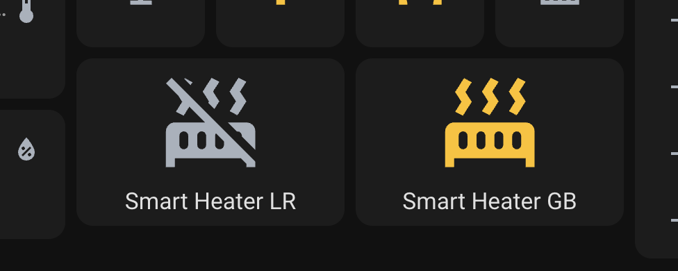

# Govee Smart Heater H7131 Integration for Home Assistant

## Overview

This guide provides step-by-step instructions for integrating the Govee Smart Heater H7131 into Home Assistant using the Govee Developer API.

## Features

- Turn heater on/off through Home Assistant
- Monitor heater state
- Automatic state updates every 30 seconds
- Support for multiple heaters (optional)
- Uses modern [template integration](https://www.home-assistant.io/integrations/template/) syntax

## Prerequisites

Before you begin, make sure you have the following:

- [Govee Smart Heater H7131](https://www.amazon.com/Govee-Heating-Thermostat-Portable-Electric/dp/B0B2ZMKSGC/)
- Govee Home app ([iOS](https://apps.apple.com/us/app/govee-home/id1395696823), [Android](https://play.google.com/store/apps/details?id=com.govee.home&hl=en_US&gl=US)) with already added device
- Home Assistant installed and running

## Integration Steps

### 1. Obtain Govee Developer API Key

Use the [Apply Govee-API-Key](https://developer.govee.com/reference/apply-you-govee-api-key) instructions to get your API key.

### 2. Get device ID using Govee Developer API

Make a request to the [Govee Developer API](https://govee-public.s3.amazonaws.com/developer-docs/GoveeDeveloperAPIReference.pdf) to get the list of devices, replacing YOUR_GOVEE_API_KEY with the API key obtained in the previous step.

```
curl --location 'https://openapi.api.govee.com/router/api/v1/user/devices' \
--header 'Content-Type: application/json'
--header 'Govee-API-Key: YOUR_GOVEE_API_KEY'
```

```
wget --no-check-certificate --quiet \
  --method GET \
  --timeout=0 \
  --header 'Govee-API-Key: YOUR_GOVEE_API_KEY' \
  --header 'Content-Type: application/json' \
   'https://openapi.api.govee.com/router/api/v1/user/devices'
```

### 3. Configure Home Assistant

Add lines from configuration.yaml, scripts.yaml, automations.yaml and secrets.yaml to your configuration files. You should replace YOUR_GOVEE_API_KEY and YOUR_GOVEE_DEVICE_1_ID in these files beforehand. If you need to add a second device, uncomment the appropriate lines in scripts.yaml, configuration.yaml and automations.yaml.

### 4. Restart Home Assistant

Restart Home Assistant to apply the changes made to the configuration.

### 5. Add a button to the Home Assistant panel



## Migrating from the legacy switch syntax

If you set this integration up before December 2025, your `configuration.yaml` probably used the legacy `switch:` block with `platform: template`. Home Assistant deprecated that syntax and it stops working in version 2026.6, so you will see a "Legacy switch template deprecation" item under Settings > Repairs.

To migrate, replace the old `switch: / platform: template / switches:` block with the modern `template: / - switch:` block from `configuration.yaml` in this repo. The key changes are `value_template` to `state`, `friendly_name` to `name`, `icon_template` to `icon`, and `service:` to `action:` inside `turn_on` and `turn_off`.

The example here uses `unique_id`, which is right for a fresh setup. If you are migrating an existing setup and want to keep your current entity IDs (so dashboards and automations keep working), add `default_entity_id: switch.your_existing_id` to each switch instead, then restart Home Assistant to apply the changes.

## Contributing

Feel free to submit issues and pull requests to improve this integration.

Happy automating! 🏡✨
